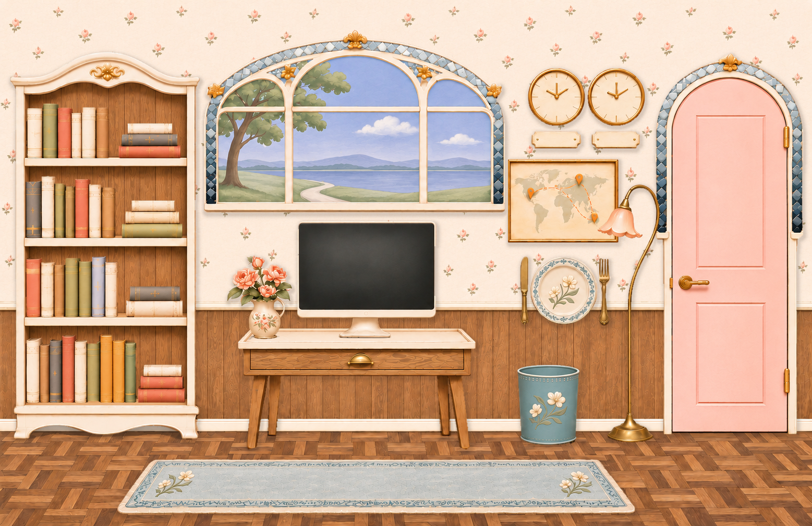

# Desk Sweet Top

Home Sweet Home is a native macOS desktop prototype. Hand-drawn furniture set against a wall and floor serves as an interactive way to launch apps from your desktop.



## Current Version

- The room is built from 27 separate layers. The scene fills the screen in full-screen mode, and furniture keeps its original proportions.
- The room editor lets you import or generate backgrounds, add and move furniture, resize it, and save and switch between layouts.
- The in-room monitor opens a pale, misty blue browser picker. Choose Chrome or Safari and a half-screen or full-screen window. The app reuses existing browser sessions whenever possible.
- The app follows your preferred macOS language and supports English, Simplified Chinese, and Traditional Chinese.

Furniture other than the monitor is currently decorative.

## Run Locally

On a Mac with the Xcode Command Line Tools installed, run these commands from the repository root.

```sh
zsh scripts/build-monitor-app.sh
open output/local-test/HomeSweetHome.app
```

On first launch, load the original layout in the room editor and save it to enter the room. Click the monitor to choose a browser and window mode. Use `⌘E` to edit the layout, `⌃⌘F` to toggle full-screen mode, and `⌘Q` to quit.

macOS may ask for Automation and Accessibility permissions if the app needs to resize browser windows automatically. See the [local testing guide](app/LOCAL-TEST.md) for details.

## Run Tests

```sh
output/local-test/HomeSweetHome.app/Contents/MacOS/HomeSweetHome --self-test
output/local-test/HomeSweetHome.app/Contents/MacOS/HomeSweetHome --capture-test output/local-test
output/local-test/HomeSweetHome.app/Contents/MacOS/HomeSweetHome --type-test output/local-test/monitor-typeset
```

The tests use a mock browser driver and leave your browser sessions untouched. Room layouts are stored on your Mac. OpenSpec change records are in `openspec/`.

The repository includes the current editable PSD, transparent PNGs, and required source assets. See the [transparent layer notes](assets/design/v3/layers-v3-22-refined/README.md) for details.
